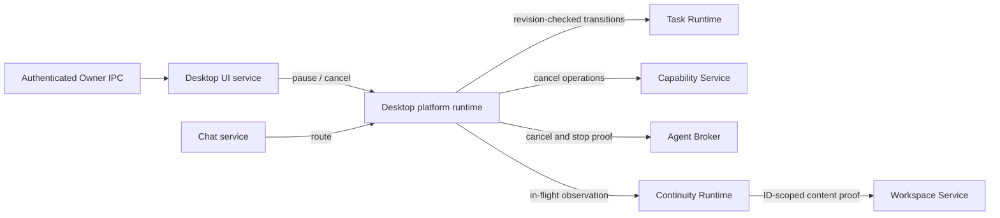

# Core command and state boundaries

Core has one composition root in `src/app/service-container.js`. It assembles
the existing domain services and binds their callbacks. A large number of
imports here is expected; domain state machines must not import the composition
root or Desktop presentation code.

## Authority and projections

| State | Authoritative owner | Other modules use |
| --- | --- | --- |
| Task status, revision, assignment | Task Runtime and Task Store | Revision-checked commands; cloned Task records |
| Attempt and Checkpoint | Task Runtime, persisted with the Task | Attempt/evidence and checkpoint commands; no independent Task status |
| Agent Session | Agent Broker and the selected provider | Session commands and provider-specific lifecycle proof |
| Workspace identity and settings | Workspace Service and Registry | ID-scoped resolution and policy |
| Workspace file facts | Current filesystem and native Git, observed through Workspace Service | Bounded content hashes, Git facts and Broker-authorized file operations; registry metadata is not file truth |
| Workspace writer after assignment | Task Runtime's active owner evaluation | Owner query; no UI-maintained lock |
| Pre-attachment provisioning and retained Agent startup ownership | Capability Service requests journal and in-process provisioning maps | Provisioning/recovery observations; not a second Task owner |
| Request idempotency | Capability Service requests journal | Request fingerprint and retained result; not proof of dispatch completion |
| Operation effect and replay identity | Capability Broker dispatches journal; tool coordinator owns its separate continuation receipt | Bound commands and review acknowledgements; one record cannot stand in for another effect |
| Approval | Capability approval store | Broker decision API; approval alone does not prove an effect finished |
| Memory | Memory Runtime, policy and store | Authorized reads, writes and references; context and working-memory snapshots are derived |
| Plugin Instance | Extension Runtime and its store/host lifecycle | Runtime commands and read projections; capability revocation is not host-exit proof |
| Handoff transaction | Continuity Runtime | Rollover/review commands; Task assignment changes only through Task Runtime |

Task status, Agent process state and tool effects answer different questions.
For example, a blocked Task may still have an external process or an unconfirmed
effect. Neither `blocked` nor a missing in-memory Session permits another writer.
Keep both the pre-attachment provisioning fence and the assigned Task owner.

## Application commands

Authenticated Owner IPC enters the Desktop UI service. UI parameter validation,
bounded DTO projection and UI events remain there. The existing Desktop platform
runtime coordinates Owner pause/cancel; Task Runtime performs each persisted
transition. Chat uses that same platform runtime for routed execution.

Start/resume and Owner reconciliation still have application coordination in
the Desktop service. They must use the same Task commands, fresh admission and
execution evidence. Do not introduce a second Task Runtime to relocate these
call sites. The provider eligibility predicate in `agent/execution-security.js`
is shared by assignment and Work admission. The Capability Broker rechecks live
dispatch conditions; this check is necessary after asynchronous preparation.
Configured native credentials and authenticated external sessions have distinct
admission rules, and no selector grants execution consent.

Pause/cancel must retain revision checks, active child checks, Handoff exclusion,
unknown-operation rejection and confirmed external stop evidence. Pause is not
a process termination receipt. Failed cancellation retains evidence and the
Workspace fence. A missing Managed Session can be resolved under the existing
Core-local policy; an unknown external transport cannot.

Known Handoff, unfinished Owner recovery and retained startup ownership are
checked before Task mutation or operation cancellation. The same application
predicate is checked again after awaited cancellation; an earlier observation
does not authorize a later stop. A rejected control action must not manufacture
a blocked Task or interfere with the operation that caused its refusal.

One-shot approvals and finite grants share the existing approval store but are
distinct record kinds. `approvals.list()` exposes actionable one-shot decisions;
`listGrants()` exposes bounded authority separately. A pending grant activates
only when its source approval is consumed and never becomes a second decision.

## Workspace proof contract

`WorkspaceService.collectContentProof(id, { expectedRoot, relevantFiles })` is
a Core-only observation. It requires a registered ID, optionally checks the
resolved root against the caller's earlier observation, and obtains all root
exclusions and managed-worktree provenance from Workspace's own state. It does
not accept caller-supplied exclusion lists or a replacement trusted root. It
never falls back to the active Workspace and never recovers an import journal.

`collectRecoveryProof(id)` is the distinct Owner recovery path. It retains the
existing write/recovery fence before using the same private proof assembly.
Continuity supplies the resolved Workspace ID to its content-proof callback;
an unavailable or mismatched observation remains unverified.

Owner recovery binds the Task revision, exact operation references, current
Session-stop evidence and content hash to the reviewed intent. Fresh evidence
is required after an asynchronous boundary or a partial acknowledgement. The
Owner can release a safely reviewed old assignment or give a fresh instruction
on the same Task. Historical unknown effects are never replayed automatically.
Non-Git recovery uses content evidence and retained operation receipts; a text
confirmation or file-name match is insufficient.

## Dependency regression

`npm test -- --suite test-core-dependency-directions` parses literal imports,
exports, `require` and dynamic imports using the existing esbuild dependency.
It rejects file-level import cycles, imports of authoritative stores from
unapproved consumers (including store-exporting barrels), and Task/Memory
state-machine dependencies on application or execution coordinators through
helper files. Core consumers use direct service/type imports instead of store
barrels. Workspace's public facade exports registry metadata, not its constructor.
Startup schema validation is a deliberate read-only
exception. The fixture includes a cycle, wrong import directions and import-like
comments/strings to verify the checker itself.

These checks do not infer computed module names, callback authority or event
lifetimes. DI, IPC and event reviews remain necessary. Domain-level two-way
relations can legitimately represent a command in one direction and a read
projection in the other; collapsing domains into nodes is not proof of a
file-level cycle or competing state authority.
