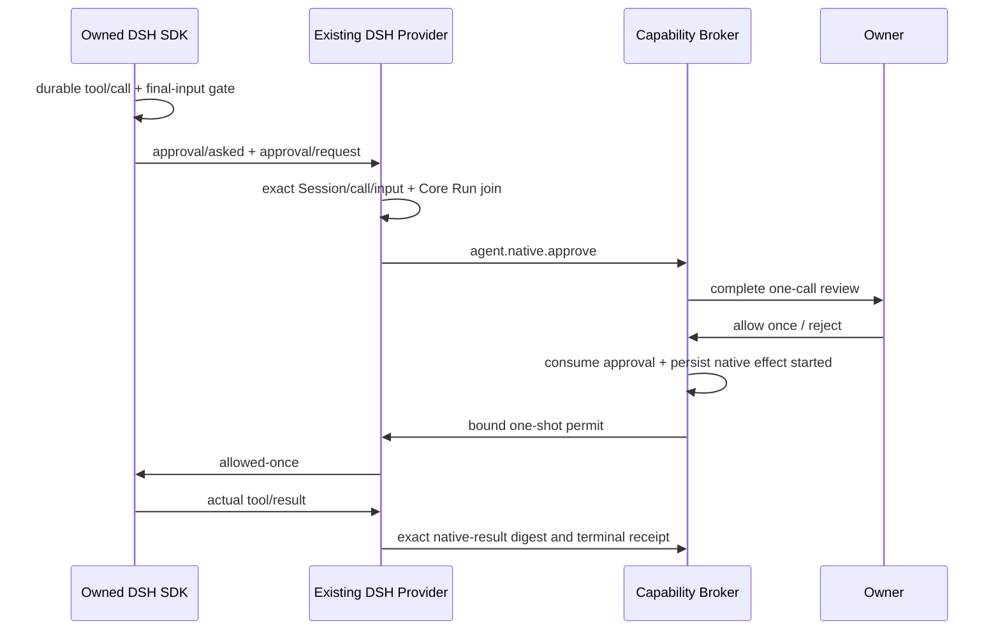

# DSH 连接与预设兼容边界

CetaMesh 保留已有 Core DSH HTTP connector，并通过同一个 DSH AgentProvider 为任务提供受控 SDK stdio 传输。它不会自动安装或升级 DSH，不会修改或重启用户正在运行的 HTTP 服务。Owner 明确配置兼容运行时后，Core 为每个新 Task Session 启动独立 SDK 进程。适配依据旧版 `0.1.5-rc.1` 的实际接口与官方 [`dsh-v0.2.2-rc.1`](https://github.com/deepseek-ai/deepseek-harness/releases/tag/dsh-v0.2.2-rc.1)；新版源码固定为 `66491b05e3f05ad35bcdd4f6cd7ed26041d9e3db`。包版本、服务连接、预设格式、工具审批与任务资格分别报告。

## 保留的 HTTP 接口

这些接口用于原有连接、目录、社交和会话观测，不为新 Task 提供工具执行授权。不会把 SDK 的独立进程审批接口套到 HTTP Session，也不会自动迁移旧 HTTP Session。

| 接口 | 生产者 → Core 消费者 | 兼容规则 |
| --- | --- | --- |
| `settings/describe`, `session/list` | DSH API Gateway → DSH Provider health/status | 保留 Typert `client-request/server-response` envelope；Session 列表须包含 `items` 及明确的 `sessionId/running`，HTTP 成功但 schema 不明不能标记兼容 |
| `agentPresets/list`, `agentPresets/read` | DSH preset registry → Core catalog/preset policy | 不要求旧版 `trust` 元数据；只读文档必须返回与请求一致的 `agentPreset` 及有界 YAML 内容。新版 `broken?: string` 表示加载失败；非法字段类型不当作健康证据 |
| `session/modelCatalog`, `session/selectModel` | DSH model configuration → Provider model control | 保留现有目录与精确 `selected` 回执；模型与 reasoning 不从预设名猜测 |
| `session/create`, `session/prompt` | Core Provider → DSH Session | 保留命名参数 `request`、显式所选 `agentPreset` 与现有内容块协议；不自动采用 DSH 默认预设 |
| `session/follow` | DSH `/api/remote.mux` → Core follow hub | 保留 open/item/end/error/cancel framing、snapshot 的 durable records/cursor/projections 与 `surfaceOp`；新增只读 API 不替换已验证的 follow 路径 |
| `session/cancel`, `workspace/archiveSession`, resume | Core lifecycle → DSH | 取消请求不证明停止；归档不证明进程停止，亦不保证从列表消失。Resume 查现有 Session，不因不存在而新建 |

HTTP/WebSocket 合成 peer 覆盖两种版本的上述公共接口，不等于已在新版真实模型与原生工具上验收。旧版不提供的 `session/state`、`session/projections` 不是该公共路径的必要条件；不向不存在的接口重放写请求。

Provider 关闭同时拥有尚未完成的创建操作。预设校验与远端创建返回后均重新检查关闭状态；远端创建结果不明时保留 pending 归属及暂存目录。只有取消后读取到唯一同 ID、`running:false` 的 Session，才可报告停止并清理；缺项、重复 ID、仍在运行或单纯 archive/close 回执均不替代停止证明。关闭等待有界，`PROVIDER_CLOSE_UNKNOWN` 保留后续核验所需的记录。

新的创建请求若返回已归属的 Session ID，报 `DSH_SESSION_ID_CONFLICT`。它不会修改旧会话的模型、Task 绑定或暂存目录，也不会把旧会话当作新请求的清理对象。新请求的未知结果继续保留，后续唯一 ID 的合法请求仍走原创建流程。

## 预设发现与明确选择

本机 `.agent-presets/<id>/agent.cordis.yml` 与 authenticated `agentPresets/read` 复用同一有界 persona parser。预设 ID、`trust`、默认标记以及 persona 格式均不授予工具权限。目录读取仅用于发现；Owner 在执行器页面选择任务预设并保存，配置按原有版本化连接文件持久化，当前 Core generation 及其 Session 保持原配置，重启 Core 后采用待生效配置。

`local-persona-only` 仅表示本机 persona 格式；绑定真实 connector 时，同名本机文档还必须与 DSH 实际返回文档的 SHA-256 指纹一致。该检查避免用同名本机文件为不同的系统预设背书，但不证明工具经过 Core。无论预设来自本机还是原生 registry，未接必经工具审批的 HTTP Provider 都不能创建新 Task staging/Session。

Windows 的 home 路径仅大小写不同时，还须核对实际目录的非零设备及文件身份一致。大小写敏感目录中的不同对象、不同目录及其他 junction 别名不能共享原连接的预设或凭据范围；异步保存仍检查配置 revision，不能覆盖并发的新选择。

原生系统预设可被发现、读取、校验格式并由 Owner 显式保存，标记为 `native-persona-only`。缺少受控工具边界时，Task Provider 返回 `taskEligible: false` / `native-tool-policy-unverified`，在创建 staging 前以 `DSH_TOOL_APPROVAL_UNAVAILABLE` 拒绝。SDK Task 使用下述固定受控组合，不继承所选 HTTP 原生预设。

## 原生工具的协议限制

官方 [approval request](https://github.com/deepseek-ai/deepseek-harness/blob/66491b05e3f05ad35bcdd4f6cd7ed26041d9e3db/docs/subsystems/approval.md) 通过 `callId` 引用已记录的工具调用。原生 `tool/call` 的工具名与完整原始 arguments 在 prepare/审批前提交；PTC 的 `tool/ptc-dispatch-start` 同样先记录 exact normalized arguments。正式 `$events` / `$events/result` waterfall 可传回应答。审批消息没有重复携带参数，不代表整个协议无法取得完整输入。

`approval.policy: ask` 只处理已经要求审批的操作，工具 pre-execute 默认允许；该选项不强制每个工具都询问 Core。HTTP Gateway 把问题发给多个 owner Client，首个 result 完成决定，因而当前 HTTP 连接不能证明 Core 是必经的审批者，继续拒绝原生 Task 执行。SDK 传输只在独立、无 HTTP/UI 应答者的受控组合中使用官方 `approvalRequests` / `approval/request`。

新版提供 [`tools.guard`](https://github.com/deepseek-ai/deepseek-harness/blob/66491b05e3f05ad35bcdd4f6cd7ed26041d9e3db/packages/core/tools/README.md) 和 `tools/pre-execute` 扩展点。受控 SDK 组合在全局 pre-execute 中要求一次性 Core 审批，同步 guard 与实际 dispatch 再核对同一 execution token、Agent 对象、Session、工具名和完整参数；跳过异步审批也没有可用许可。SDK server 依赖 gate 的 readiness 服务，gate 缺失时不能完成初始化。此机制不是宿主 OS 沙箱，也不隔离同进程中的恶意插件，因此不加载任意用户插件。

## 受控 SDK Task 连接

首期只接受已验证的 `0.2.2-rc.1` CLI、SDK server、sdk-minimal、审批服务和工具 pipeline 组合。运行时检查包含关键模块、pipeline/shared 文件和 package routing manifest 的精确指纹；独立 Node 需要 `24.9+`。SEA Core 通过独立 Node 启动 CLI 模块，不把自身可执行文件当作 Node 使用。配置发生变化或文件不再匹配时，已有批准不能沿用。

如需安装单独的兼容环境，可由 Owner 在自己的运行时目录执行：

```powershell
npm install --prefix <专用运行时目录> @deepseek-ai/dsh-sdk-client@0.2.2-rc.1
```

使用精确版本；SDK-client 的不带版本 `latest` 标签不保证与 CLI 兼容。然后在 DSH 的“受控 SDK 任务连接设置”填写该配对安装内的 `@deepseek-ai/dsh/package.json` 或 `lib/bin.js` 的绝对路径、独立 Node 路径、端点、模型和专用 API 凭据。官方 DeepSeek 端点为 `https://api.deepseek.com/anthropic`，该固定版本使用 Anthropic Messages 协议；根 API URL 不是兼容的任务端点。

配置由现有 AgentRuntimeConfiguration 管理，存入独立 `agent/dsh-runtime.json`，专用 Key 进入现有受保护凭据存储的 `agent-dsh` 引用；JSON 和 SDK profile 不保存 Key。旧 `agent-runtimes.json` 保持原字节，旧版本不读取新配置文件，回滚不需要迁移旧 Agent 配置。旧产品不能执行新的 SDK 任务，其已有历史和状态仍须保留，不能通过删除记录回滚。此连接不读取 Model Runtime 的模型目录或用户 DSH home 中的凭据。保存配置不发模型请求；启动探针不发 Prompt；配置过的 Key 不标为已验证账号。

每个任务使用新建私有 home、完整 sdk-minimal bootstrap 和固定 overlay。首期仅开放 `read`、`write`、`edit`，禁用持久/后台 Shell、PTC、子 Agent、MCP 和动态插件；不继承 HTTP agentPreset。模型在新 Session 初始化时选定；不静默修改运行中的配置，不支持的模型来源、模型或推理设置在启动前明确拒绝。

工具审批链为：



官方 ApprovalRequest 的 callId 与工具参数之间，通过官方 durable `tool/call`、`approval/asked` 和受控 gate 的结构化 reason 三方核对。首期 final input 必须与原始 JSON 完整一致；缺失、归一化差异、重复身份、迟到或跨 Run 请求均拒绝。reason 最多 64 KiB，现有 NativeApproval 的完整审核摘要最多 8192 UTF-8 字节；超限拒绝，不以截断后的参数获取批准。

SDK 工具许可与 Workspace 导入是两笔独立审批。放行前在现有 `capability/dispatches.json` 保存 native effect 意图，只有实际工具终态回执可以结清。失败的 `write/edit` 可能已有部分副作用，保留 `outcome-unknown`。固定且已校验的 `read` 实现由可信 Transport 绑定 `dsh-staging-read-v1` 策略到原审批与 journal，真实终态错误记为 `failed`，可以接收新的执行指令，不因文件不存在制造未知写入。运行时指纹同时固定其本地文件后端；旧记录、缺少策略或仅结果中声称只读均不获得该例外。失败工具证据仍为失败，不记作成功。

取消、断线、Core 重启或审批完成本身都不代表工具完成；即使是 `read`，缺少真实结果仍保持未知。运行中撤销后不再放行，迟到批准不执行；没有结果的已放行操作不可重放。

文件路径在 Core 审批前及放行前都核对同一个 staging 根、目录身份和实际路径，拒绝越界、junction 逃逸、ADS 和原生 Home 展开语法 `~`、`~/…`、`~\…`。DSH 原生后端会展开这些 Home 写法，Core 的通用路径核验将其视为字面路径，因此直接拒绝，不能批准后再静默改写参数。相对路径及 staging 内绝对路径正常使用。这些检查复用已有文件边界，不提供 OS 沙箱，也不消除通用文件系统边界中检查与使用之间的竞争窗口。

SDK 文件工具在现有 staging 工作区内执行；`workspace.apply` 审批前原项目保持不变。导入仍绑定可信 Core Run；原生工具等待与导入等待分别投影。已确认停止后，拒绝导入或无法核验的 staging 保留在受保护目录，不因关闭 Session 丢弃。SDK Session 的停止凭据复用现有原生生命周期实现并存入独立 DSH namespace，不修改 Codex 历史。恢复需要停止凭据、Workspace 事实和既有操作核验；旧 HTTP 缺少停止证明时仍保持阻断。

## 验证与支持范围

`test-dsh-sdk-gate`、`test-dsh-sdk-transport`、`test-dsh-sdk-runtime`、`test-dsh-staging-approval` 和现有 NativeApproval 回归覆盖协议、权限、版本和故障边界。`test-dsh-sdk-composition` 验证正式 Core/UI DTO 配置；`test-dsh-sdk-native-loop` 是显式 opt-in 的真实 Windows CLI、真实 Core、原生文件工具与本地合成模型验收，需要受审核的独立监督器，不使用全局 DSH 或真实模型账号。

支持标记为 **PARTIAL**：受控文件工具链与旧 HTTP 连接各有明确范围。真实 CLI、合成模型和真实 Core 的成功，不替代付费模型账号资格、Windows 原生界面、其他工具或发布安全验收。扩展 Shell、PTC、子 Agent、MCP、其他版本或任意原生预设前，必须补齐对应的必经审批、子进程停止和未知效果回归。

| 能力 | 当前范围与验证等级 |
| --- | --- |
| 旧 HTTP 连接、预设目录与历史观测 | 保留原接口；协议 fixture 覆盖，不能由此获得新 Task 工具权限 |
| HTTP 原生预设工具执行 | `BLOCKED_PROTOCOL`：当前无法证明 Core 是必经执行前应答者 |
| 固定 SDK `read/write/edit` | `PARTIAL`：真实 0.2.2-rc.1 CLI、真实 Core、原生文件工具及本地合成 Messages 模型通过；逐次 Core 审批，写入另需导入审批 |
| 同 Task 继续、暂停后 Fresh Session、取消与丢失结果 | 真实 CLI/Core 故障验收覆盖；正常结束与未知效果拒绝分别核验，失败读取保留真实失败记录 |
| 实际远端模型与账户资格 | 不由配置、启动探针或合成服务推导；必须在明确授权的账户与预算中另行验收 |
| Windows 已安装原生产品 | 需要包含修复的验收构建独立验证，浏览器 DTO/组件测试不替代原生产品结果 |
| Shell、PTC、后台工具、MCP、子 Agent、任意插件或其他版本 | 此受控适配暂不开放，不因为 DSH 自身提供它们就显示为任务可执行 |

## 回归入口

使用根测试入口：

```sh
npm test -- --suite test-dsh-setup --suite test-dsh-connector-m3 --suite test-dsh-model-selection --suite test-agent-provider
npm test -- --suite test-agents-page-ui
```

`test-dsh-setup` 导入 owned synthetic HTTP/remote.mux helpers，覆盖旧/新 roster、精确文档绑定正反例、异常与损坏 schema、显式选择保存、本机正例与原生工具拒绝。UI suite 的浏览器执行取决于环境开关与可用浏览器；真实 DSH 模型、收费 API 和新版原生工具验收须单独记录，不能从 fixture PASS 推导。
