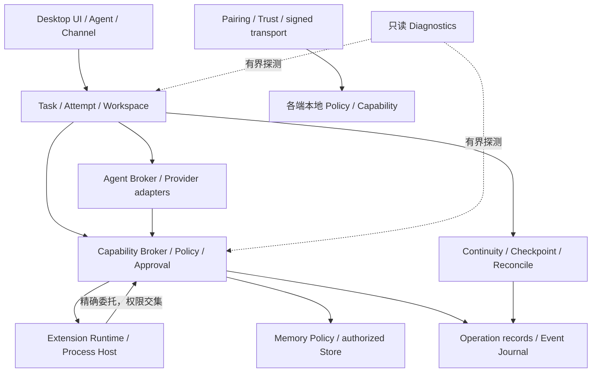

# CetaMesh 核心协议与开发契约

本目录维护协议索引、事实源及兼容约束。**CP 文档成熟度统一为 PROPOSED**；引入开发规范与校验不等于批准部署新协议或实现所有目标能力。现有生产协议继续由下表对应代码和已发布规范负责。

整合基线为本地 `4f49dfc9aafb9e6300876c8c813da51ffedf7f82`（2026-10-31）。用户提供的 v1.0 / v1.1 PluginMesh 草案依据较早公开 `5330c5e`；采用 v1.1 的完整 CP 族，五份独立 CP-022..026 与包内版本逐字节一致。原始 README、实施指令、历史审计、迁移计划及生成脚本保留在私有开发归档，不能当作当前实现事实。文档包 **v1.1** 不改变 Manifest v1、Worker v1 或 Pairing v1.1 的版本。

## 阅读与变更流程

1. 修改对应领域前阅读 [治理规则](CP-000-GOVERNANCE.md)、本索引及该领域 CP，确认实际生产者、消费者和持久化所有者。
2. 更新当前实现映射，记录 `EXISTING / ALIGNMENT / NEW / DEPRECATED / BLOCKED_ENV`。这些是变更类别，不能替代实现状态和测试结果。
3. 新领域 DTO 先做 Schema、合成正反例和语义约束测试；适配现有契约，保持旧字节、错误码、权限与数据格式。
4. 改变签名、framing、必填字段、默认权限、数据出口或持久化语义时，使用 [ADR 模板](ADR-TEMPLATE.md) 单独评审兼容、迁移、回滚与发布门禁。
5. 根 `npm test` 是 Desktop 入口；共享契约还需 `npm --prefix apps/mobile test`。没有原生/设备/外部服务证据时明确标记未验收。双端通过与 Owner 审阅是升级为 STABLE 的必要条件。

## 协议索引

| 协议 | 范围 | 当前整合类别 |
| --- | --- | --- |
| [CP-000](CP-000-GOVERNANCE.md) | 治理、版本、事实源与废弃 | ALIGNMENT |
| [CP-001](CP-001-CORE-CONTRACT.md) | 新领域消息与错误投影 | NEW；不替换既有 wire |
| [CP-010](CP-010-AGENT-PROVIDER.md) | AgentProvider 与 Broker | EXISTING 基础 / ALIGNMENT；新 Descriptor 为 NEW |
| [CP-020](CP-020-EXTENSION.md) | Manifest v1 / Process Host | EXISTING 基础 / ALIGNMENT |
| [CP-021](CP-021-PLUGIN-INTEROP.md) | 精确委托与权限交集 | EXISTING 基础 / ALIGNMENT；见下方缺口 |
| [CP-022](CP-022-PLUGIN-TAXONOMY-17.md) | 17 类产品分类 | NEW 元数据；非 17 套 Runtime |
| [CP-023](CP-023-NESTED-PLUGINS.md) | 包嵌套、依赖图与独立身份 | NEW；只读草案图校验可运行 |
| [CP-024](CP-024-PLUGIN-MESH-ORCHESTRATION.md) | Invoke / 订阅 / 引用协作 | ALIGNMENT + NEW；不建第二条 Plugin Bus |
| [CP-025](CP-025-PLUGIN-SDK-DEVELOPMENT.md) | 分类开发、SDK 和验收 | ALIGNMENT + NEW；现有 SDK 入口仍有效 |
| [CP-026](CP-026-PLUGIN-COMPAT-SECURITY.md) | 版本锁、供应链、迁移安全 | ALIGNMENT + NEW |
| [CP-030](CP-030-MEMORY.md) | Memory Scope / Pack / Adapter | EXISTING 基础 / ALIGNMENT；Backend Adapter 为 NEW |
| [CP-040](CP-040-SECURITY.md) | Capability / Policy / Approval / 效果 | EXISTING 基础 / ALIGNMENT |
| [CP-050](CP-050-TASK-CONTINUITY.md) | Task / Attempt / Checkpoint / Handoff | EXISTING 基础 / ALIGNMENT |
| [CP-060](CP-060-TRANSPORT-EVENTS.md) | 多传输、取消、背压与事件 | EXISTING framing / NEW 领域投影 |
| [CP-070](CP-070-MESH.md) | Trust、配对与跨端授权 | EXISTING 配对 / ALIGNMENT |
| [CP-080](CP-080-SIMULATION-CHANNEL.md) | Simulation 与可选 Channel | PARTIAL 原生基础；旧渠道与历史数据保留，人工保真待验收 |
| [CP-090](CP-090-HEALTH-DIAGNOSTICS.md) | 启动门禁、健康、反馈 | EXISTING 本地实现 / NEW 报告投影 |

## 依赖与所有权



“Plugin Mesh”是上述组件的协作视图，不是新调度器、权限中心、任务库、Memory Store 或事件真相源。分类、发现、登录、配对、安装和角色人格均不授予执行权。任何外部 Agent 原生工具若不经过 Broker，其宿主边界必须如实披露。

## 当前实现映射与兼容矩阵

测试列列出可执行的现有证据入口，**不是运行结果记录**。测试通过只覆盖各 suite 实际断言；真机/服务验证单独记录。后续实现变化必须同步本矩阵。

| 领域 / 变更类别 | 生产者 → 消费者、持久数据 | 代码事实源与兼容边界 | 测试入口与剩余工作 |
| --- | --- | --- | --- |
| Agent / EXISTING + ALIGNMENT | Provider → Broker → Chat/Task/Continuity；Session 为执行引用 | [AgentProvider](../../src/agent/agent-provider.js)、[Broker](../../src/agent/broker.js)、[Native permission bridge](../../src/agent/protocol/agent-permission-bridge.js)；10 核心 + 3 可选方法。不支持显式 unsupported；Task 不随 Session 更换身份 | `test-agent-provider`, `test-agent-broker`, `test-agent-protocol-lifecycle`, `test-chat-codex-regression`；新 Descriptor DTO 尚未生产使用；真实 Provider 当前未重验 |
| Manifest / EXISTING | Installer / Registry → Runtime / Host；已安装记录与私有存储 | [Manifest](../../src/extension/manifest.js)、[词表](../../src/extension/types.js)、[Runtime](../../src/extension/runtime.js)；Manifest v1 仅七个技术 type；额外分类不变成权限 | `test-extension-runtime`, `test-process-extension-host`, `test-extension-capability`；旧包继续可解析；App/System Host 尚未交付 |
| 委托 / EXISTING + ALIGNMENT | Caller Host → Core Broker → Target Host；审计/授权关联 | [Runtime](../../src/extension/runtime.js) 精确 delegates（1–20）、祖先状态/指纹检查、最多 8 hops、授权交集 | `test-extension-lifecycle-authority` 覆盖真实 Worker 委托与失权；显式运行时环检测、完整 A→B→C 组合生命周期及全局并发预算仍需专项实现/证明，不能把草案图测试算成真实多级执行 |
| 组合侧车 / NEW | 开发者 DTO → **开发验证工具**；不写 Runtime 状态 | [组合 ADR](ADR-PLUGIN-COMPOSITION-V1-PROPOSAL.md)、[验证器](../../scripts/lib/protocol-proposals.mjs)；5 层（含根）、32 节点（含根）、每父 8 子项；包深度与运行 8 hops 分离 | `test-protocol-proposals` 检查父图/绑定 DAG、路径/身份冲突。Resolver、安装计划、包实物 Hash/链接校验、可信锁、staging/rollback、共享引用计数均为 NEW，未自动启用 |
| 事件 / EXISTING + NEW | 现有 channel data-adapter → Runtime；将来订阅意图 → Core lease | [Event Host](../../src/extension/event-host.js)、[领域操作账本](../../src/capability/operations.js)；远端事件协议不是通用内部 Pub/Sub；现有领域账本不是通用事件总线 | `test-extension-events`；草案订阅 DTO 不签发 lease、不触发外部写入；通用订阅、ack/游标/回环预算仍为 NEW |
| Memory / EXISTING + ALIGNMENT | 用户/候选/Task → Memory Policy → Store → 授权上下文 | [Policy](../../src/memory/policy.js)、[Runtime](../../src/memory/runtime.js)、[Pack](../../src/extension/memory-pack.js)；保持 JSON Store、八类型/五 Scope/四来源、长期确认、data-only Pack | `test-memory-runtime`, `test-memory-closeout`, `test-extension-capability`；草案 MemoryReference 不授予读取；可替换 Backend 与 plugin namespace 迁移为 NEW |
| 权限与效果 / EXISTING + ALIGNMENT | 可信入口 → Policy / Approval → 执行者；有限授权、操作记录及回执 | [Broker](../../src/capability/broker.js)、[L2](../../src/capability/l2-grants.js)、[操作身份](../../src/capability/operation-identity.js)、[操作续接](../../src/capability/operation-continuation.js)；未知效果先对账，不能从取消推导无副作用 | `test-capability-broker`, `test-security-negatives`, `test-extension-lifecycle-authority`；新 CP 错误投影不覆盖已暴露错误码 |
| Task / Continuity / EXISTING | Task → Attempt → Broker/Provider → 独立验收；Checkpoint / Packet / Workspace | [Task](../../src/task/types.js)、[Packet](../../src/continuity/types.js)、[Reconcile](../../src/continuity/reconcile.js)；复用权威任务状态与真实 Workspace，禁止用摘要替代证据 | `test-task-runtime`, `test-workspace-reconciliation`, `test-continuity-rollover`；新 Coordination Plan 只为设计，不是第二 Scheduler |
| IPC / Worker / EXISTING | Native Shell/UI → Core；Core → Extension Worker；Provider → 事件消费者 | [IPC](../../src/control/ipc-protocol.js) v1：4-byte LE + UTF-8 JSON，1 MiB；[Worker](../../src/extension/process-transport.js) v1 JSONL，上限 2 MiB；[Agent JSONL](../../src/agent/protocol/json-rpc-transport.js) 保持适配独立 | `test-ipc-protocol`, `test-process-extension-host`, `test-agent-protocol-lifecycle`；CP-001 不是这些 wire 的下一版本 |
| Pairing / EXISTING | Desktop [Pairing](../../src/mesh/pairing/protocol.js) ↔ Mobile [PairingProtocol](../../apps/mobile/src/protocol/PairingProtocol.ts)；Trust 与本地 grants 分离 | [已实现 Pairing v1.1](UNIFIED_PAIRING_V1_1.md) 权威；保留 `protocol:cetamesh/version:1`、签名字节与 TLS pin。旧 [Mesh envelope](../../src/mesh/protocol.js) 另有字段，不能混用 | `test-mesh-pairing-interop`, `test-monorepo-contract` + Mobile `npm test`；本次不修改两份 golden fixtures；双设备 E2E 当前未重验 |
| Mobile / EXISTING + ALIGNMENT | Feature → Runtime → Domain/Repo/Provider → Native；SQLite / secure storage 独立 | [Mobile Architecture](../../apps/mobile/docs/architecture/MOBILE_ARCHITECTURE.md)、[Extension manifest](../../apps/mobile/src/domain/extension/ExtensionManifest.ts)；只声明/远程数据插件、Local Only、未知权限 DENY，不复制 Node Process Host | Mobile `npm test` 覆盖本地契约；没有 Android/iOS 原生 Host/设备验收，不能标 STABLE 或宣称 Desktop 插件直接兼容 |
| Simulation / Channel / PARTIAL | [原生 Simulation](../../src/simulation/) 复用既有模型/Task/Memory；原 [Bionic](../../src/bionic/) / [QQ](../../src/channel/qq/) 保留 | 原生房间不依赖 QQ/DSH；角色全文、版本、范例、有限讨论和真实 Task 桥接已实施。私有历史不自动迁移；不删除旧渠道与资产 | `test-simulation-persona/runtime/project/integration/ui`；实际模型与原生窗口独立验收；完整旧版人格迁移须人工保真确认，见 [实现边界](../desktop/SIMULATION.md) |
| Diagnostics / EXISTING + NEW | [Bootstrap](../../src/app/bootstrap.js) / Shell → [诊断](../../src/product/startup-diagnostics.js) → UI / 本地报告 | 已有有界检查、BLOCKED/DEGRADED、白名单、执行门禁和反馈；CP-090 的简化 Descriptor/报告为 NEW 投影，不能套到实际报告 | `test-startup-diagnostics`, `test-startup-diagnostics-ipc`；本次不重写已完成 UI/原生能力；真实安装/Defender 安全门禁独立 |

17 类目录的 `baselineStatus` 是来源草案的描述，**不是当前能力注册表**。仅 `catalogVersion/kind/status/categories` 为可校验产品分类资料；发现和调用必须看实际 Descriptor/授权/健康。

## 草案校验与验收级别

运行 [契约工具](../../contracts/README.md)：

```sh
npm run contracts:validate
npm run contracts:validate -- plugin-composition path/to/composition.json
npm test -- --suite test-protocol-proposals
npm test -- --suite test-mesh-pairing-interop --suite test-monorepo-contract
npm --prefix apps/mobile test
```

CLI 为只读开发工具，失败退出非零，输入上限 1 MiB；只编译仓库拥有的 Schema，不访问网络或加载外部 `$ref`。合成 fixture 预期 FAIL 被拒绝是测试通过，不能解释为真实运行故障已修复。JSON Schema 结构通过、图不变量通过、生产适配契约通过、真实 E2E 是四个不同层次。

## 后续实施边界

当前可用于规范后续开发；不自动启动下一阶段。组合安装、锁文件和依赖审批应先形成可审查的只读 Preview，再实现受控 Host staging/rollback；通用事件、Memory Backend、App/OS Host 分别评审。原生 Simulation 以实现映射中的有限范围为准。权限扩大和历史数据迁移不能因本目录存在而获批。Defender RELEASE HOLD、现有 GitCode/升级端点与独立平台发布边界保持不变。
